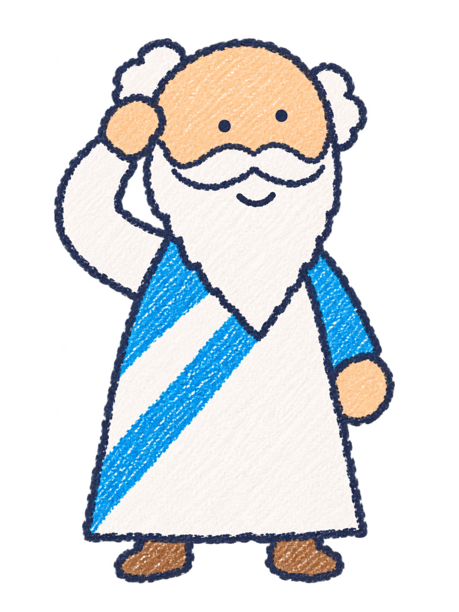
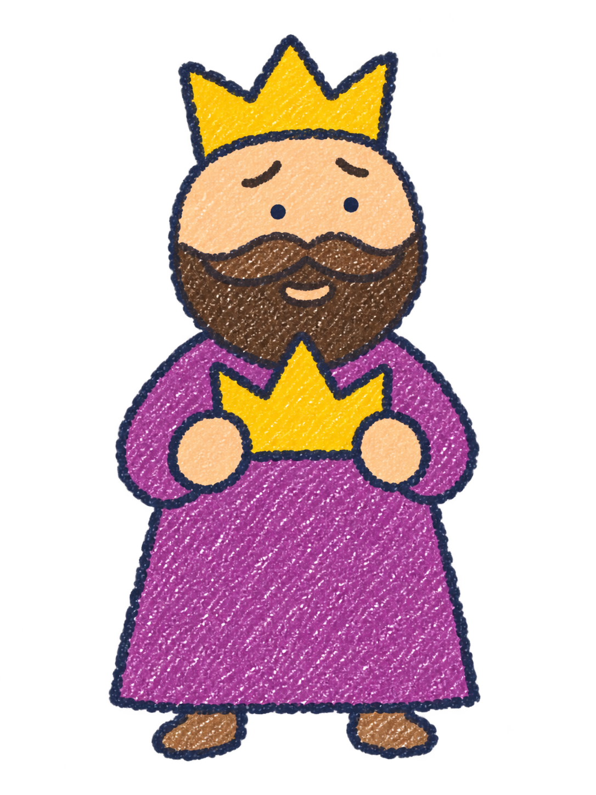
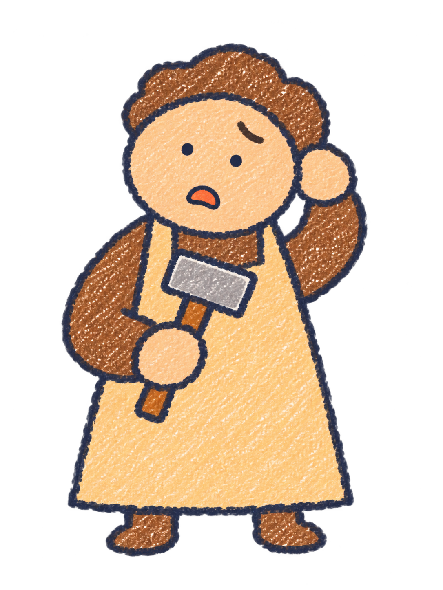
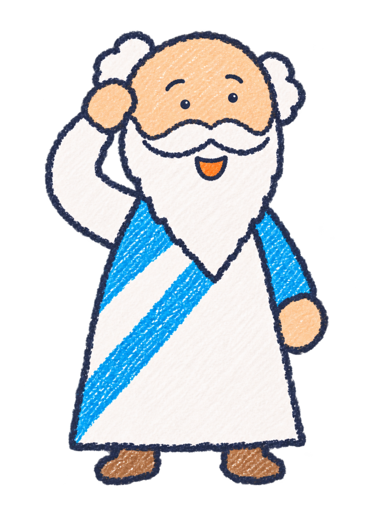
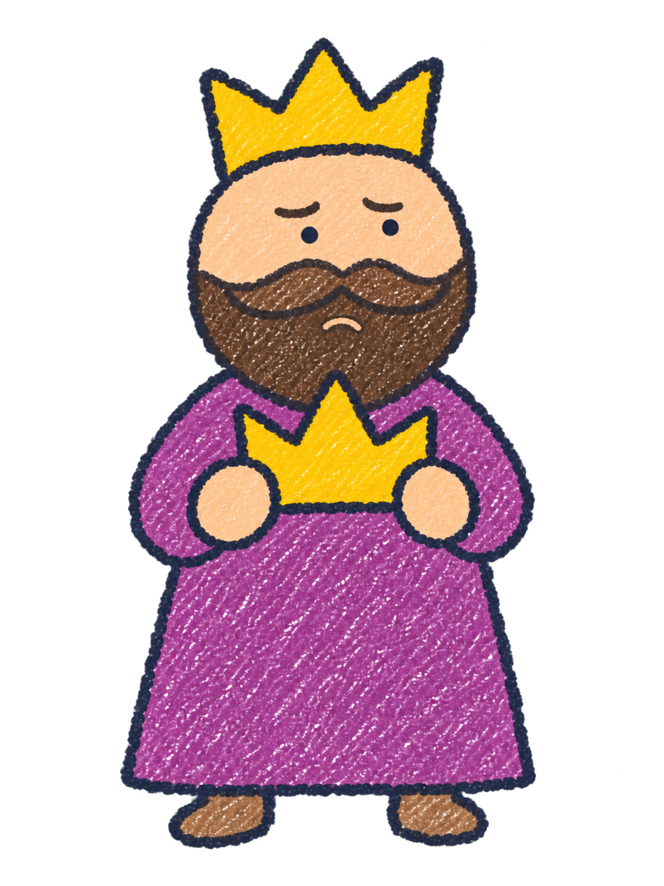
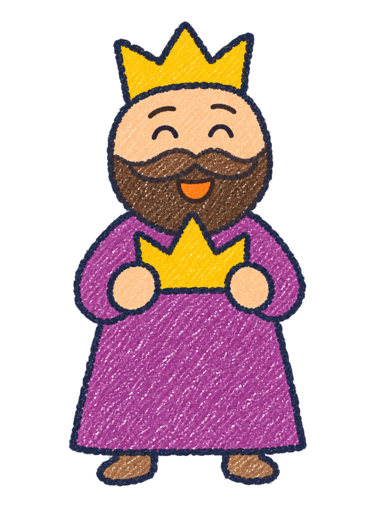
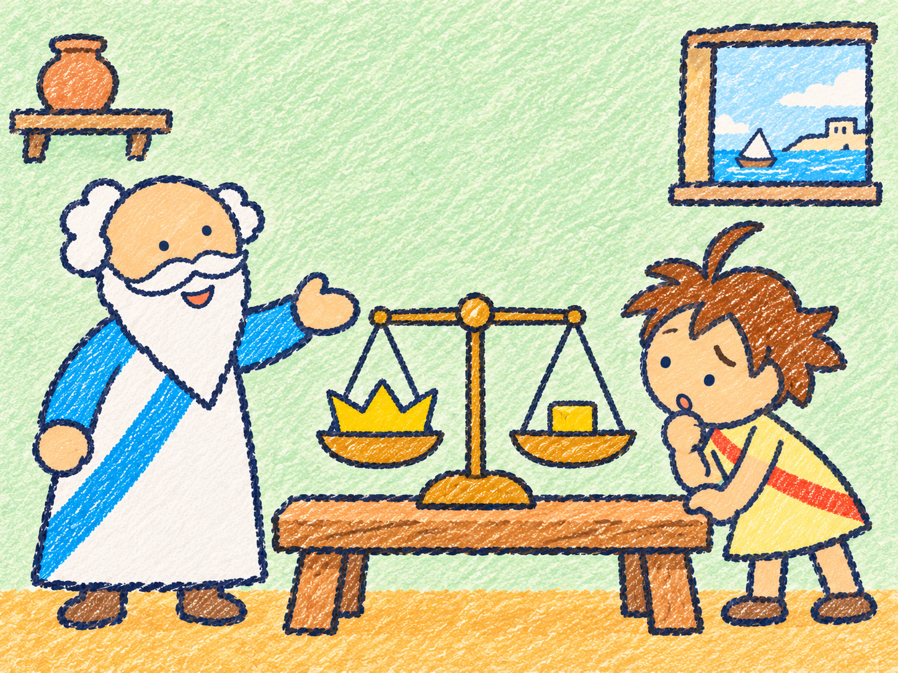
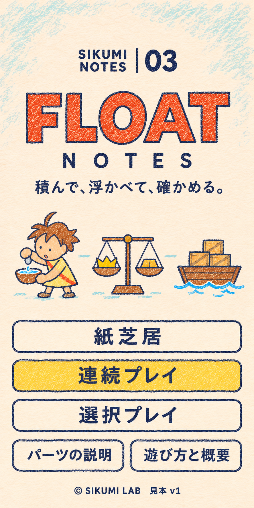
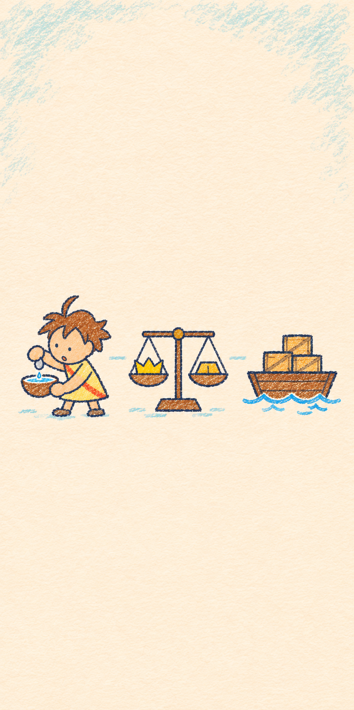

# FLOAT NOTES：優先度1の絵の見本

2026-11-05 / SIKUMI NOTES 03

発案者の「作ってもらった絵をGitHubのリポジトリにアップ」の依頼により、前回作成した原本14枚を登録しました。絵柄を確認するための見本です。画面への組み込みや優先度2以降の制作は行っていません。

基準画像は [character-sheet-2026-11-05.png](../../reference/character-sheet-2026-11-05.png)。口が口ひげの下、ひげの中に収まる形を引き継いでいます。

## キャラクター立ち絵

| アルキメデス | ヒエロン2世 | 金細工師 | 見習いの少年 |
|---|---|---|---|
|  |  |  |  |

## 表情差分

| 少年：なぜ？ | 少年：え？ | 少年：うれしい |
|---|---|---|
|  |  |  |

| 師匠：考える | 師匠：ひらめき | 王：疑い | 王：安心 |
|---|---|---|---|
|  |  |  |  |

## 序章の紙芝居：工房

師匠が見習いに、王冠を壊さず調べるよう促す場面です。天秤は空気中でつり合っています。語りやセリフは絵に含めていません。

## タイトル画面案

前2作の配置を引き継ぎ、見習い・王冠の天秤・荷物の船を象徴の絵にしています。前2作の精霊は使っていません。

| 確認用の画面案 | 文字なし原画 |
|---|---|
|  |  |

`14-title-review.png` は文字とメニューの配置を示す静止画です。実装時に画面全体をこの画像で置き換えるものではありません。`13-title-artwork.png` は文言を画面側で変えられる文字なし原画です。

## 全ファイル

| ファイル | 内容 | 大きさ | 背景 |
|---|---|---|---|
| [01-archimedes-standing.png](01-archimedes-standing.png) | アルキメデスの立ち絵 | 1086×1448 | 透過 |
| [02-hiero-standing.png](02-hiero-standing.png) | ヒエロン2世の立ち絵 | 1086×1448 | 透過 |
| [03-goldsmith-standing.png](03-goldsmith-standing.png) | 金細工師の立ち絵 | 1086×1448 | 透過 |
| [04-apprentice-standing.png](04-apprentice-standing.png) | 見習いの少年の立ち絵 | 1086×1448 | 透過 |
| [05-apprentice-why.png](05-apprentice-why.png) | 少年・なぜ？ | 1086×1448 | 透過 |
| [06-apprentice-surprised.png](06-apprentice-surprised.png) | 少年・え？ | 1086×1448 | 透過 |
| [07-apprentice-happy.png](07-apprentice-happy.png) | 少年・うれしい | 1086×1448 | 透過 |
| [08-archimedes-thinking.png](08-archimedes-thinking.png) | 師匠・考える | 1086×1448 | 透過 |
| [09-archimedes-eureka.png](09-archimedes-eureka.png) | 師匠・ひらめき | 1086×1448 | 透過 |
| [10-hiero-doubt.png](10-hiero-doubt.png) | 王・疑い | 1086×1448 | 透過 |
| [11-hiero-relieved.png](11-hiero-relieved.png) | 王・安心 | 1086×1448 | 透過 |
| [12-prologue-workshop.png](12-prologue-workshop.png) | 序章：工房での指示 | 1448×1086 | 紙の背景 |
| [13-title-artwork.png](13-title-artwork.png) | タイトル：文字なし原画 | 887×1774 | 紙の背景 |
| [14-title-review.png](14-title-review.png) | タイトル：文字とメニューを配置した確認用見本 | 887×1774 | 紙の背景 |

原本のPNGをそのまま保存しています（画像合計約22.8MB）。配信用の軽量化は、採用する絵と組み込み方を決めてから行います。

[生成指示](prompts.md) / [寸法・ファイル照合情報](manifest.json) / [素材一覧](../../assets.md)

内蔵 image_gen で生成しました。アプリへの組み込み・公開・実機での表示や操作の確認は今回行っていません。

