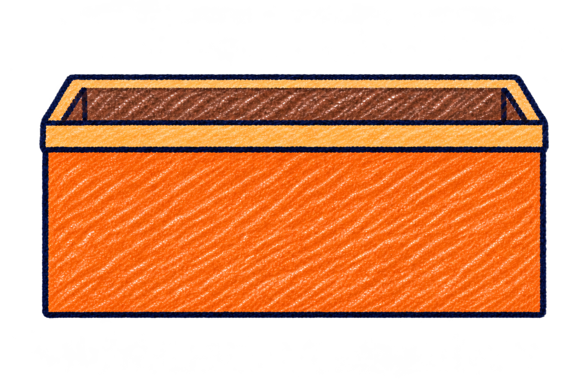
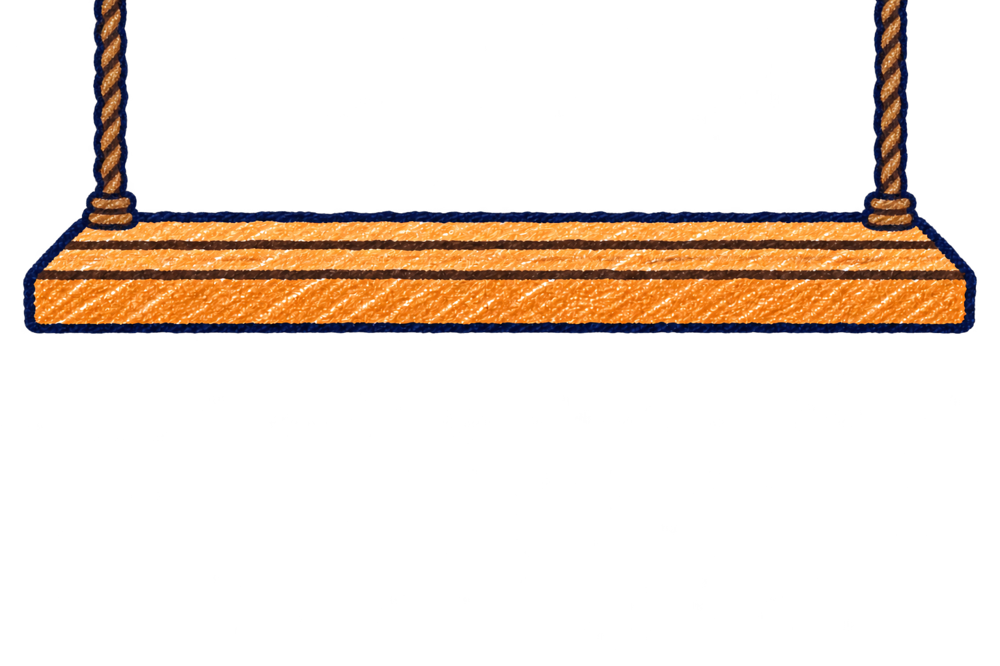

# FLOAT NOTES 船・低い橋の修正版 v2

2026-11-05。発案者による優先度2見本の採用後、指定の2点だけを修正した見本です。採用済みのクレヨンの手描き・紙の質感を引き継ぎました。

| 対象 | 修正内容 | 画像 |
|---|---|---|
| 船（08） | 船そのものの幅と高さを約2:1に変更。側面を広く取り、空の積載場所も上に見せる | [08-boat-empty.png](08-boat-empty.png) |
| 低い橋（22） | 上から吊るす形。橋の下に橋脚や縄を出さず、左から右への通路を確保 | [22-obstacle-low-bridge.png](22-obstacle-low-bridge.png) |

## 船

透明な余白を除いた外形は、幅1330px・高さ639px、約2.08:1です（不透明度128/255以上の範囲）。画像枠は1536×1024pxです。前の縁より下は、目盛りを重ねやすい広い側面にしています。目盛り、深さの数字、荷物、水面は描き込んでいません。

## 低い橋

橋を上の2本の縄で吊るす構造です。縄は画像の上端へ続く描き方で、橋の下側には支柱がありません。床板の底より下の通路が画像の左右端までつながります。

透過の数値も確認しました。下側（y=550〜1023）の全幅は、不透明度が最大1/255で、99.8%以上が完全透明です。見た目を遮る部材はありません。暗い画面での画像プレビューに見える周囲の色は、不透明な背景ではありません。

## 保存・確認範囲

内蔵 image_gen で編集し、生成したPNGを加工せず保存しました。両方とも透過PNGです。[生成指示](prompts.md)、寸法・外形・透過・SHA-256等の[照合情報](manifest.json)を併記しています。

元の[優先度2 v1](../2026-11-05-priority2-v1/README.md)は残しています。今回の変更は見本2枚と素材資料のみで、コードや既存の画像は変更していません。実際のゲーム画面での配置や通過判定は、この素材登録では確認していません。
