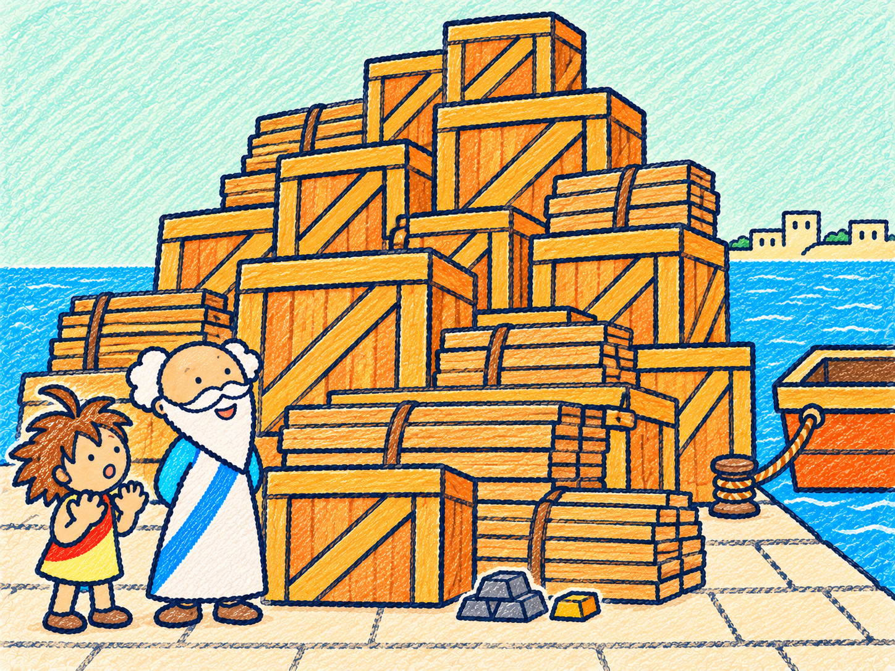
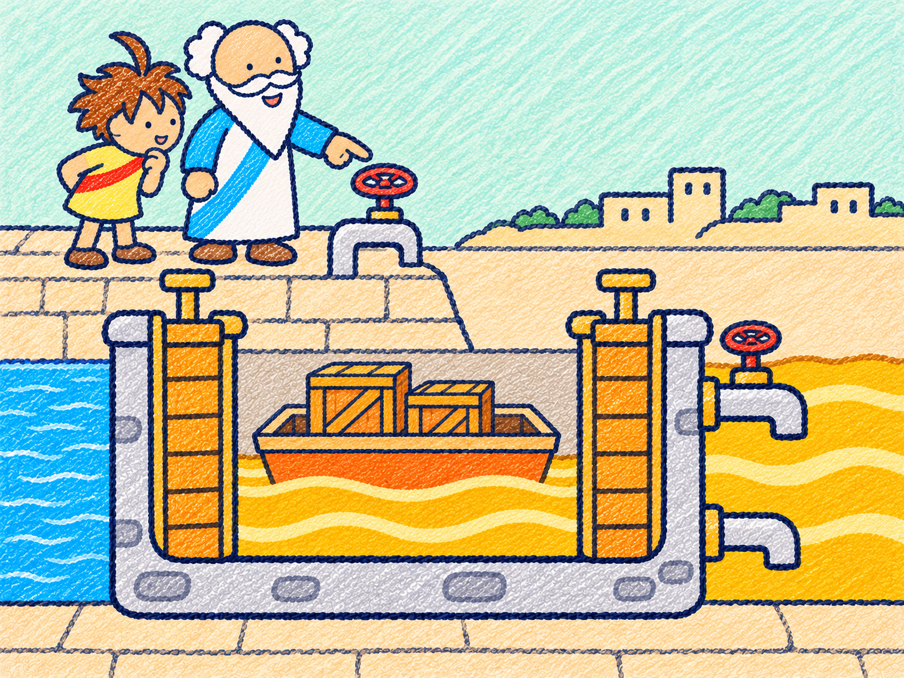
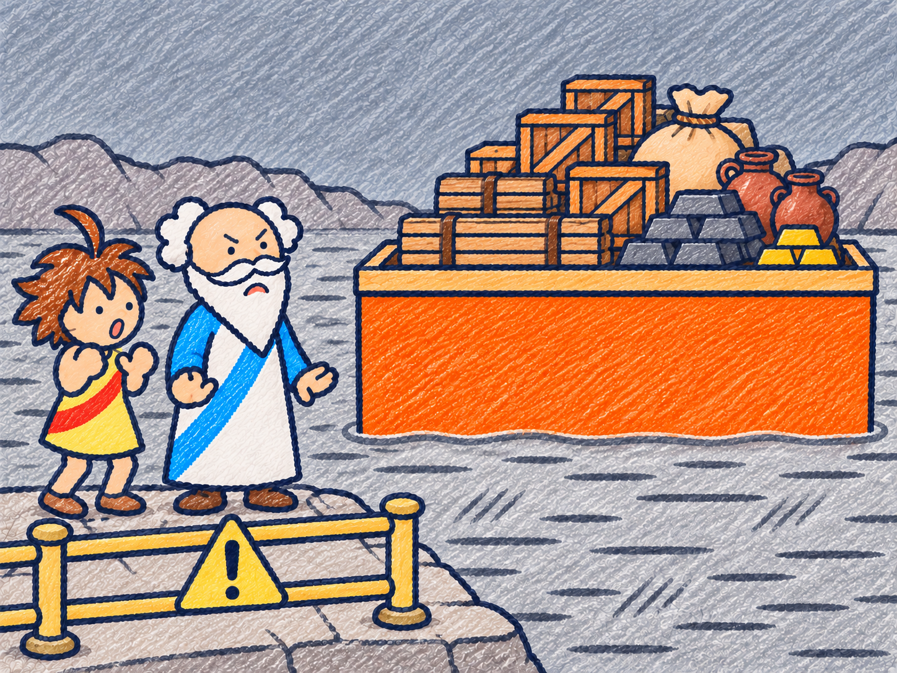

# FLOAT NOTES 序章の天秤・面に付く紙芝居 v1

2026-11-06。採用済みのクレヨンの手描き・紙の質感で、発案者指定の5枚を作りました。語りや説明文は画像に描き込んでいません。

| 順 | 名前 | 内容 |
|---|---|---|
| 1 | [序章：空気中の天秤](01-balance-air.png) | 王冠と純金がつり合う。左右の皿は同じ高さ。 |
| 2 | [序章：水中の天秤](02-balance-underwater.png) | 王冠側が上がる。王冠・純金・両方の皿の全体が水面より下。 |
| 3 | [面の紙芝居：荷物の大きさ](03-chapter-cargo-size.png) | 木箱と板が、人物の背丈を大きく超える山になって港に届く。 |
| 4 | [面の紙芝居：油の湖と入れ替え室](04-chapter-oil-exchange.png) | 青い水と黄色い油を閉じた扉で仕切る、架空の入れ替え室。 |
| 5 | [面の紙芝居：銀色の湖](05-chapter-silver-lake.png) | 荷を山積みした船が浅く浮き、乾いた岸の見習いが驚く。灰銀色と注意の印で警戒を示す。 |

各画像は1448×1086px、4:3の背景付きPNGです。内蔵 image_gen で生成・編集し、選んだ最終原本を加工せず保存しました。

## 序章：空気中の天秤

王冠と純金がつり合う。左右の皿は同じ高さ。

## 序章：水中の天秤

王冠側が上がる。王冠・純金・両方の皿の全体が水面より下。

左が王冠、右が純金で、空気中の絵と配置をそろえています。水中は青い水平線を液面として明示し、高い王冠側にも水面までの余裕を確保しています。両皿は水槽の底にも接していません。紐は皿の両縁へつながります。

## 面の紙芝居：荷物の大きさ

木箱と板が、人物の背丈を大きく超える山になって港に届く。

## 面の紙芝居：油の湖と入れ替え室

青い水と黄色い油を閉じた扉で仕切る、架空の入れ替え室。

入れ替え室は、二つの閉じた扉と給排液用の配管を持つ架空の設備として描きました。水と油が自由に接する境界にはしていません。

## 面の紙芝居：銀色の湖

荷を山積みした船が浅く浮き、乾いた岸の見習いが驚く。灰銀色と注意の印で警戒を示す。

**水銀の湖は架空の設定です。本物の水銀は毒性が強いため、触れないでください。**

この注意文は画像の外に表示するための文です。組み込む際も、絵と一緒に読める位置へ表示してください。人物は乾いた岸に立ち、液体には触れていません。泳ぐ・遊ぶ・きらめく宝物の湖のような描写は避け、冷たい灰銀色、警戒する表情、注意の印にしています。

## 確認したことと範囲

- 5枚が開けるPNGで、寸法がそろっていること、生成原本と保存コピーのバイト列が一致することを確認しました。
- 絵を目視し、空気中の釣り合い、水中の王冠側の上昇と両物・両皿の完全な水没、荷物の山、仕切られた油と水、銀色の湖での浅い浮き方を確認しました。
- 語り・台詞・説明文・数字は焼き込んでいません。銀色の湖の三角形内の印は注意を示す記号です。
- 天秤と船の描写は物語の見本です。絵の傾きや面積から計算・判定を行うものではありません。
- 今回は見本の登録だけです。アプリへの組み込み、実画面の表示、スマホ実機の確認は行っていません。コード、版、計算、判定、既存画像は変更していません。

王冠の話は伝承、見習いと液体の入れ替え室・水銀の湖は創作・架空の設定です。

[生成指示](prompts.md)と[寸法・照合情報](manifest.json)を保存しています。
