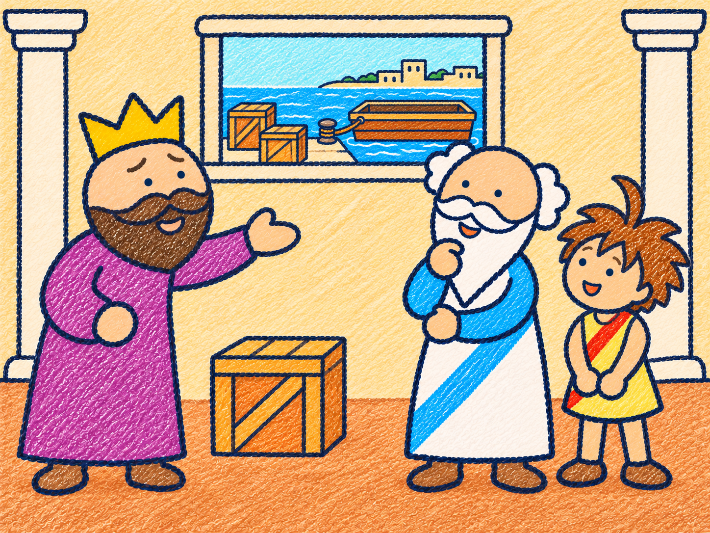

# FLOAT NOTES 序章・宮殿の紙芝居2枚 v1

2026-11-06。発案者指定の序章の場面を、採用済みのクレヨンの手描き・紙の質感で追加しました。語り・セリフ・説明文は画像に入れていません。

| 順 | 場面 | 画像 |
|---|---|---|
| 1 | 金細工師が捕らえられる場面 | [PNG](01-prologue-goldsmith-escorted.png) |
| 2 | 王の勅命の場面 | [PNG](02-prologue-royal-command.png) |

## 金細工師が捕らえられる場面

王が机の王冠を前に命じ、兵士が金細工師の隣を歩いて出口へ案内する。縄や拘束具、乱暴な接触は描かない。

## 王の勅命の場面

宮殿内で王がアルキメデスと見習いへ港の荷の運搬を命じる。師匠と見習いは隣に立ち、木箱と窓の港が命令の対象を示す。

## 保存と確認

- 2枚とも1448×1086px、4:3、背景付きPNGです。
- 内蔵 image_gen で生成し、最終原本を加工せずコピーしました。
- 人物の服・髪・ひげと口の位置、王冠、宮殿、立ち位置、やわらかい連行、語りや文字が入っていないことを目視確認しました。
- PNGが開けること、寸法、生成原本とコピーのバイト列の一致を確認しました。[照合情報](manifest.json)と[生成指示](prompts.md)を保存しています。
- 今回は素材の見本のみの追加です。コード、アプリの版、計算・判定、既存の画像は変更していません。アプリへの組み込みと実機確認は行っていません。

伝承をもとにした作品内の場面です。実際の歴史を再現した資料としては扱いません。
