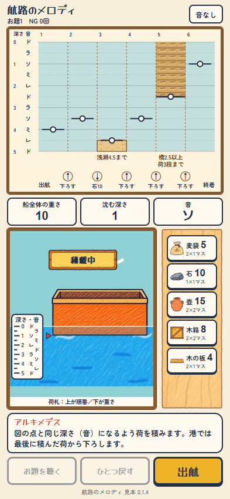

# 航路のメロディ：優先度1の画面と絵の見本

2026-11-21、見本 **0.1.4の絵と画面配置を発案者が採用しました。** 本体への組み込みは未実施です。

依頼書4章の優先度1は完了です。本体の流れへの組み込みはClaudeの担当です。港の新しい演出・導入の紙芝居・横置きとPCの仕上げ（優先度2・3）は、次工程として未着手です。

## まず見るもの

- [選択肢全体を木の板にした画面](shelf-board-393x851.png)
- [練習の画面](practice-ready-393x851.png)
- [お題と浅瀬・橋](route-ready-414x896.png)
- [消音で正解した画面](correct-393x851.png)
- [消音でメロディが違った画面](mismatch-393x851.png)
- [エキスパートの準備画面](expert-393x851.png)
- [1マスの荷札](one-cell-tag-393x851.png)
- [文字なしの看板](blank-status-board.png)

画面画像の文字は、HTML/SVGで表示した結果の確認用です。素材のPNGには文字を描き込んでいません。



選択肢の後ろ全体は縦長の木の板です。0.1.4では「枠に選択肢が重なっている」という指摘を受け、背景専用の平らな板 `cargo-board-v2.png` に差し替えました。太い縁取りをなくし、選択肢の周囲に上・下12px以上、左・右10pxの木肌が見えるように配置しています。荷を積んで選択肢が減っても板が残ります。キャラクターは置きません。

## 動く見本

本体と分けた `proto/melody-visual/` にあります。元の `proto/melody/` は変更していません。

```sh
node scripts/build-melody-visual.js
```

`artifact/melody-visual.html` ができ、単体のHTMLとして開けます。試作専用の「自由／練習／お題1」「フリーの選択欄」「帰着のド・下／上」は画面内に置いていません。音あり／音なしの切替は残しています。

別のお題や手がかりの見え方を確認する場合は、URLだけを切り替えます。これは見本の確認用で、本番の選択欄ではありません。

| 見る状態 | URL末尾 |
|---|---|
| 練習 | `index.html` |
| お題1・すべての手がかり | `index.html?lesson=route1` |
| お題1・ノーマル | `index.html?lesson=route1&hints=normal` |
| お題1・エキスパート | `index.html?lesson=route1&hints=expert` |

元の動く試作の「練習」「お題1」「自由」は、制作前に操作して流れを確認しています。

## 依頼項目と描き方

| 項目 | この見本での扱い |
|---|---|
| 航海図 | 上が浅い／高い音、下が深い／低い音。白い○がお題。深さ・音名・各海路・港はSVGと画面の文字で描く |
| 港の印 | ↑は荷下ろし、↓は積載。積載する荷の名前と重さを常時表示 |
| 浅瀬 | 指定の深さより下を砂色の海底にする。砂の短い線を繰り返す模様で、海路幅が変わっても絵をつぶさない |
| 橋 | 指定の深さより上を木の模様でふさぐ。下面と限界の深さをそろえ、「荷○段まで」を併記 |
| 航海中の船 | 採用済みの船の絵を再利用。現在の海路・実際の深さの高さに置く |
| 合否の線 | ○のお題に実際の線を重ねる。一致は緑＋✓と音名、不一致は赤＋×と音名。同じ海路の上部に記号を並べ、船の絵と重ねない |
| 看板 | 文字なしPNGの板に、画面側で「積載中」「荷下ろし中」を重ねる |
| 荷札 | 白い紙札の上に赤い積載順、下に重さ。1マスの石にも同じ札を付け、「上が順番／下が重さ」と案内 |
| 棚の背景 | 右側全体に、太い枠のない平らな木の板。選択肢は縁から余白を取り、板の内側へ配置する |
| 1画面の配置 | 上から、航海図／重さ・深さ・音／船と棚／語り／お題を聴く・ひとつ戻す・出航。見本の版は最下段に小さく表示 |

## 見た目の基準

本体の紙 `#f7efdc`、濃い紺 `#23304a`、木枠 `#8a5a2e`、朱 `#d6452c`、黄 `#efb32a`、水色 `#8fd0d4` を引き継ぎます。本文はZen Maru Gothic、語り手とボタンはYusei Magicです。重さの数字にはArialの太字を使います。Safari系の検査で元の数字の書体が細く見えたため、小さな荷札の読みやすさを優先して調整しました。

航海図は読み取るための図なので、点・目盛りの位置は正確にそろえます。紙の粒・砂・木の繰り返し模様と、既存のクレヨンの船・荷で絵柄を合わせています。

## 保持したこと

計算、音、積み下ろしの順、自動積載の置き場所、関門、お題、判定、最後の帰着は元の試作のままです。コピーした試作は画面案の確認用で、流れの本体実装として採用するものではありません。

`node scripts/check-melody-visual.js` で、元の試作と見本のデータ・計算式・積み下ろし／出航／合否／音の処理が一致することを照合できます。練習の文は同じ意味の短い案にしています。既存の試作の動きは残していますが、優先度2の新しい演出を開発したものではありません。

帰着の上／下のド、面数、荷の数の上限、ほかの液体を使う時期は、この画面案では決定していません。音は試作の既定値を引き継いでいます。

## 検証と保存

Chromiumで393×851（Pixel 6a相当）、414×896（iPhone XR相当）、390×844、375×812、360×740の5サイズ・計20状態の配置を検査しました。[配置の記録](verification-layout.json)

0.1.4では、ページのはみ出しに加えて、選択肢と板の外縁の間隔も検査しています。選択肢が5個・2個・1個・0個の計28状態をChromiumの5サイズとWebKitの2サイズで確認し、選択肢が板の内側に収まること、文字のはみ出しがないこと、ボタンを押せることを確認しました。[板の内側の検査記録](verification-shelf-insets.json)

加えて、ChromiumとWebKit（Safari系）のそれぞれで393×851・414×896の2サイズ・各20状態を操作しました。正解・不一致の消音再生、浅瀬・橋のある航路の完走、手がかりの伏せ方、難しさを変えてもお題が同じこと、荷札、戻す操作、看板の切替を確認しています。ページのはみ出し、部品同士の重なり、実行時のエラーはありません。[Chromiumの操作記録](verification-chromium.json)、[WebKitの操作記録](verification-webkit.json)

既存の `npm test` は40件合格、`npm run check` は35ファイル合格、`npm run build` は本体0.8.24・60資材の生成に成功しました。別途、見本の構文確認・単体HTML生成・元の処理との照合も成功しています。

スマホ実機の見え方・操作・聴感は未確認です。PCで画面サイズを合わせた検査とは別です。

[生成指示](prompts.md)、[素材と確認画像の情報](manifest.json)、[実装へ渡す内容](handoff.md)を同じフォルダーに保存しています。
