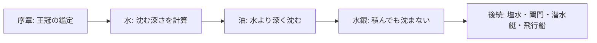

# 構想たたき台: FLOAT NOTES（フロート・ノーツ）— 浮力と比重を計算で予想する航海パズル

| 作成日 | 作成者 | 状態 | 名称 |
|--------|--------|------|------|
| 2026-11-05 | シクミラボ 田中孝宗 | 構想段階（フィードバック募集中） | 正式名称（2026-11-05 発案者が確定） |

> ⚠ この資料は思いつき段階のたたき台です。【想定】は作成者の仮置き、【要確認】は未確定事項を示します。印のない内容は発案者の考え、または発案者が相談の中で進めると判断した内容です。

## 1. 一言でいうと

荷物を積んだ船がどこまで沈むかを、液体の比重（水を1としたときの重さの比）から計算で予想して航路を進むパズルです。同じ船と荷物でも、水・油・水銀では結果が大きく変わる驚きを楽しみます。

## 2. 背景・課題

アルキメデスの法則は「物は、押しのけた液体の重さの分だけ浮く力を受ける」というものです。名前は知られていても、自分で計算して結果を当てる体験はあまりありません。

この構想は、「水に沈むものが別の液体では浮く」「体積で押しのけられた分が浮力になる」という素朴な関心から始まりました。特に、水の感覚が通用しない液体を使うと、「こんなに積んでも沈まない」という面白さが生まれそうです。

AQUA NOTES とは別の題材ですが、「計算で結果を予想して遊ぶ」点は同じです。見た目が似ないように、液体を重ねた容器ではなく、船の航海を中心にします。

## 3. 提案するアイデア

序章でアルキメデスの法則を知り、本編では船の荷物を調整しながら航路を進みます。



### 計算のしくみ

箱形の船では、船全体の重さと、押しのけた液体の重さがつり合います。そのため、次の式で沈む深さが決まります。

**沈む深さ ＝ 重さ ÷（液体の比重 × 船の底面積）**

同じ船（底面積10、高さ5）で比べると、次のようになります。

| 液体 | 比重（ゲームの設定値） | 重さ40での深さ | 沈みきる重さ | 体験 |
|------|--------:|--------:|--------:|------|
| 油 | 0.8 | 5.0 | 40 | いつもの感覚より危ない |
| 水 | 1 | 4.0 | 50 | 基準 |
| 水銀 | 13.5 | 約0.3 | 675 | いくら積んでも沈まない |

```text
油（深さ5.0）        水（深さ4.0）        水銀（約0.3）
┌────┐ ← 液面        ┌────┐              ┌────┐
│    │              ├────┤ ← 液面        │    │
│    │              │    │              │    │
│    │              │    │              │    │
│    │              │    │              ├────┤ ← 液面
└────┘              └────┘              └────┘
※同じ重さ40の船。上端が船の縁、液面より下が沈んでいる部分（図の高さは目安）
　油では液面が縁まで達し、これ以上積むと沈む
```

### 物語とキャラクター

SIKUMI NOTES（シクミ・ノーツ）の一作として、遊びと音の考え方は受け継ぎますが、キャラクターだけは前2作からガラッと変えます。前2作の案内役は星の精霊と水の精霊でした。今作は人間の物語にします。

**物語の軸:** 見習いが「分かったつもり」から出発し、「えっ？」と驚き、やって確かめて「エウレカ！」にたどり着きます。ひとつ分かると、次の「まだ分からない」が見えてきます。発案者のエッセイにある考え方が土台で、見習いには発案者自身の学び方が重なります。

| キャラクター | 役割 |
|--------------|------|
| 見習い（主人公） | アルキメデスの工房で働く子ども。プレイヤーと同じ目線で驚く。創作の人物で、史実ではない |
| アルキメデス | 少し変わった師匠。答えを教えず、「測ってごらん」と課題を出す |
| ヒエロン王 | 大きな依頼を持ち込む豪快な王 |
| 金細工師 | 序章の容疑者 |

**見せ方:** 紙芝居のようなタッチで物語を進めます。手描き風の線と紙の質感、絵を引き抜く場面転換、語り手の文、開始の拍子木などを候補にします【想定】。

### 最初の試作の範囲

1. **王冠の鑑定（序章）:** 操作つきの3面ほどで、アルキメデスの法則を体験する。①空気中で王冠と純金を天秤でつり合わせる ②水に沈めると王冠の側が上がる ③押しのけた液体の重さが浮力になると確かめ、王の荷物を積む船へつなぐ
2. **水だけの航路:** 沈む深さを計算し、重さ50を超えると沈むと体験する
3. **油の湖:** 水から入れ替え室を通って油へ移る。水では安全だった重さ45の船が、そのままでは沈むので、入る前に荷物を5以上降ろす
4. **水銀の湖:** 入れ替え室を通って水銀へ移る。いくら積んでも沈まない。水中のレバーに届かせるため、重い荷物をあえて探して積む（深さ3以上）

## 4. 想定ユーザーと利用シーン

- 【想定】計算で解くパズルが好きで、理科や数学の法則を遊びで体験したい人
- 【想定】シーン: 休憩中にスマホで1面を解き、水銀の面で「こんなに積んでも沈まないのか」と驚き、理由を説明で確かめる

## 5. 主要機能の候補

| 機能 | 概要 | 優先度（ラフ） |
|------|------|----------------|
| 王冠の鑑定 | 操作つきの序章（3面ほど）でアルキメデスの法則を体験する。2回目以降は飛ばせる | 核 |
| 荷物の積み下ろし | 重さと船の沈み方を調整する | 核 |
| 沈む深さの判定 | 式に沿って船の深さを動かす | 核 |
| 液体の変更 | 水・油・水銀で比重を変える | 核 |
| 入れ替え室 | 1面の中で別の液体へ移る架空の設備。液体が替わると、船の深さと音が変わる | 核 |
| 浅瀬・低い橋 | 上下から船の深さを制限する | 核 |
| 荷物が山積みの見た目 | 水銀で沈まない驚きを見た目で伝える | 核 |
| 紙芝居の物語 | 見習いとアルキメデスの物語を、紙芝居のタッチで進める | 核 |
| 深さの音 | 沈む深さを音の高さにする。深いほど低い音。音程は採点に使わず、消音でも遊べるようにする | 核 |
| 航路のメロディ | 航路で変わる深さの音をつなげて、メロディにする | 後続 |
| 濃度差の移動 | 真水と塩水の間で、船の浮き沈みを使う | 後続 |
| 閘門 | 水位を変えて、水のエレベーターとして使う | 後続 |
| 層の水域 | 混ざらない液体を上下に重ね、仕切りなしで通る。船が層をまたぐと、2つの液体の浮力を合計する | 後続 |
| 潜水艇 | 重りと浮きで指定の深さに止める | 後続 |
| 液体の追加 | はちみつ・溶岩・液体ガリウム・液体水素など | 後続 |
| 飛行船 | 空気の浮力を扱う | 将来 |
| 揚力 | 速さ・角度・形で変わる力を扱う | 将来 |

## 6. 実現方式の選択肢

規模感はすべて【想定】です。

| 案 | 概要 | 良い点 | 気になる点 | ざっくり規模感 |
|----|------|--------|-----------|----------------|
| 松: 物語つきの通し版 | 序章から後半までの全面、音、演出を作る | 作品として完成する | 面白さの確認前に手間がかかる | 数週間〜数か月 |
| 竹: 航海画面の試作 | 3章の4段階を、横から見た画面と簡単な動きで作る | 驚きが見た目で伝わるか確かめられる | 画面と動きの作り込みが必要 | 数日〜1週間 |
| 梅: 計算だけの試作 | 図と数字だけで問題を解く | 計算の面白さをすぐ確かめられる | 山積みの驚きは確かめにくい | 1〜2日 |

**おすすめは竹案です。** 「沈まない」驚きは見た目が重要なので、最初から確かめる価値があります。

## 7. 期待効果とリスク・懸念

- **期待効果:** 公式を読むだけでなく、自分で予想して確かめることで、法則が理解しやすくなります【想定】。
- **懸念: 単調さ:** 足し算だけで終わらないよう、沈む深さの計算と上下の制限を組み合わせます。何面まで飽きないかは未確認です。
- **懸念: 見た目:** 真水と海水のように比重が近い液体は見た目で区別できません。序盤の面からは外し、かなり後の面で塩水域への移動として使います。
- **懸念: 現実との違い:** 水銀は毒性が強いので、架空の湖や実験容器として描きます。別の液体へ横に移る場所は、架空の入れ替え室として明示します。混ざらない液体でも、横に並べたままでは重い液体が下へ、軽い液体が上へ動くので、そのままはつなぎません。
- **懸念: 発展の難しさ:** 揚力は速さ・角度・形で変わり、暗算で予想しにくいです。先に空気の浮力へ広げるほうが、同じ計算を使えます。

## 8. フィードバックをもらいたい点

1. 山積みでも沈まない船の見た目で、驚きは伝わるか？
   → 伝わるなら水銀の面を見せ場にします。伝わらなければ、演出か面の順番を変えます。
2. 序章の王冠は、3面ほどの長さで理解できるか？
   → 足りなければ面を増やし、長ければ本編へ早く入れるよう短くします。
3. 水銀で「重いものを探す」逆転の面は、油の次に入れて難しすぎないか？
   → 難しければ、水銀の前に液体ガリウムなどの予告面を追加します。

## 補助メモ（requirements-definition への申し送り）

### 初回価値と重大な行き止まり

- 最初の成果: 王冠の鑑定を終え、最初の船の深さを計算で当てる
- 到達を妨げる前提: 特になし【想定】
- 安全な中断・復帰: 沈没時のやり直し位置と、途中保存の有無は【要確認】

### 要件定義で決めるライフサイクル

| 対象リソース | 未決の観点 | 決定する工程 |
|--------------|------------|--------------|
| 荷物 | 港での積み下ろし、降ろした荷物の行き先、足りないときの救済 | requirements-definition |
| 船 | 沈没時の扱い、面ごとの船の種類、底面積の変更 | requirements-definition |
| 通路の液体 | 面の途中で液体が変わる順番、やり直し時の戻り先 | requirements-definition |

### ルール交差

| 分類A | 分類B | 未決の利用可否 |
|-------|-------|----------------|
| 液体 | 荷物 | 【要確認】落とした荷物が浮くか沈むかを遊びに使うか |
| 液体 | 船 | 【要確認】溶岩などで耐熱の船を要るようにするか |
| 深さの判定 | ちょうど上限 | 【要確認】重さ40の油、高さ5の船のような境界を「安全」とするか |

## 9. 未確定事項と次のステップ

- 【要確認】シクミ・ノーツとして、操作感・共通部品・ルールのどれを引き継ぐか（発案者）
- 【要確認】紙芝居の絵の枚数と、絵柄をそろえる作り方（試作で確認）
- 【要確認】公開先と公開時期（発案者）
- 【要確認】食用油と溶岩の比重（出典を確認してから採用する。作成者）
- 【要確認】水銀の面に出す、架空設定と注意書きの文言（要件定義）

**次のステップ**

1. **音の使いどころを詰める。** 基本方針は「沈む深さ→音の高さ」です。残りは、音色、音階、音を鳴らす場面、航路のメロディの作り方です。
2. 竹案で3章の4段階を試作し、8章の問いを確かめる
3. 方向が固まったら要件定義（requirements-definition）へ進む

## 10. 決定ログ（追記専用）

| 決定日 | 項目 | 判断 | 理由 | 再検討の条件 |
|--------|------|------|------|--------------|
| 2026-11-05 | 遊びの中心 | 計算で予想する形にする | 発案者の希望 | なし |
| 2026-11-05 | 導入 | 王冠の話でアルキメデスの法則を導入する | 本題の理解が深まりそうなため | 試作で序章が長すぎると分かったら |
| 2026-11-05 | 本題 | 船の航海を中心にする | 液体を重ねる容器は AQUA NOTES と見た目が似そうなため | 潜水艇や層を使う後半を検討するとき |
| 2026-11-05 | 最初の試作 | 王冠→水→油→水銀の4段階にする | 液体の違いによる驚きの有無を先に確かめるため | 試作の結果しだい |
| 2026-11-05 | 閘門 | 後続に回す | 面白さの原因を見分けやすくするため | 最初の試作の後 |
| 2026-11-05 | 真水と塩水 | 序盤から外し、かなり後の面で使う | 見た目がほぼ同じなため | 色分けなどで違いを示せたら |
| 2026-11-05 | 別の液体の間の移動 | 通常の閘門とは分け、架空の入れ替え室を使う案を残す | 閘門は同じ水をつなげて水位をそろえるため | 後続の液体面を設計するとき |
| 2026-11-05 | 揚力 | 将来案として保留 | 計算の予想が難しく、先に空気の浮力を扱えるため | 飛行船の面を作るとき |
| ~~2026-11-05~~ | ~~仮称~~ | ~~「FLOAT NOTES」を置く（他案: ウキシズミ航路／アルキメデス号）~~ 【失効】 | 覆り: 発案者が正式名称に確定（下行へ） | — |
| 2026-11-05 | 音の基本方針 | 沈む深さを音の高さにする | シリーズの「物理の結果を聞く」考え方を受け継ぐため | 試作で水銀の面が面白く感じられない場合 |
| 2026-11-05 | 航路のメロディ | 試作の後に発展させる | 発案者の希望。作問が難しくなるため、深さの音を先に確かめる | 深さの音の試作後 |
| 2026-11-05 | 液体の境目 | 同じ液体の高低差は閘門、別の液体への移動は入れ替え室、混ざらない液体は上下の層の水域とする | 重さの違う液体は、横に並べても門を開けても動くため | 層の水域の試作後 |
| 2026-11-05 | 層の水域 | 後続に追加する | 計算が一段難しくなるため、最初の試作には入れない | 最初の試作の後 |
| 2026-11-05 | 入れ替え室 | 最初の試作に入れる（最小の形） | 単一の液体に浮かべるだけでは、液体が替わる面白さが出ないため | 試作で分かりにくければ |
| 2026-11-05 | 序章の形 | 読むだけにせず、操作つきの3面ほどにする。2回目以降は飛ばせる | 自分で試すと法則が本編の計算につながるため | 試作で長すぎる、または理解しにくいと分かったら |
| 2026-11-05 | キャラクター | 前2作の精霊をやめ、見習い＋アルキメデスの人間の物語にする | キャラクターだけは前2作からガラッと変えたいため。見習いと発案者が重なり、提案が面白いと発案者が判断 | なし |
| 2026-11-05 | 物語の軸 | 「分かったつもり」「えっ？」「やって確かめる」「エウレカ」を軸にする | シクミ・ノーツを作りたいと思った経緯を物語に汲み取るため | なし |
| 2026-11-05 | 見せ方 | 紙芝居のようなタッチのキャラクターで物語を進める | 発案者の希望 | 試作で絵の作業量が大きすぎると分かったら |
| 2026-11-05 | シリーズ名 | SIKUMI NOTES（シクミ・ノーツ）を正式なシリーズ名として扱う | 発案者が確認。01 PRISM、02 AQUA のタイトル画面に表記あり | なし |
| 2026-11-05 | シリーズ番号 | FLOAT NOTES を 03 とする | 発案者の決定 | なし |
| 2026-11-05 | 試作の結果 | スマホ向け試作を確認し、この方向で進める。細部は動かしながら詰める | 発案者が試作を確認して判断 | なし |
| 2026-11-05 | 水銀の面の条件 | 低い橋を水中のレバーに変更 | 横から見る画面では、山積みの荷が低い橋に当たるため | なし |
| 2026-11-05 | 荷物の積み込み | 水の面は出航前の深さを隠す | 計算で予想する形にするため | 試作で調整する |
| 2026-11-05 | 音の段 | 深さ0.5ごとに音階の1音 | シリーズの音階の考え方にそろえるため | 試作で調整する |
| 2026-11-05 | ゲーム名 | 「FLOAT NOTES（フロート・ノーツ）」に確定 | 発案者の決定 | なし |

## 11. 要件定義への引継ぎ

| 種別 | 項目 | 状態 | 次工程 |
|------|------|------|--------|
| 名称 | FLOAT NOTES（フロート・ノーツ） | 確定 | 要件定義 |
| シリーズ | SIKUMI NOTES（シクミ・ノーツ）の一作。キャラクターは前2作から変える | 確定 | 要件定義 |
| シリーズ | 番号は03 | 確定 | 要件定義 |
| シリーズ | タイトル画面は 01 PRISM、02 AQUA の形式にそろえる | 【想定】 | 要件定義 |
| コア体験 | 計算で沈む深さを予想する | 確定 | 要件定義 |
| 物語 | 見習いとアルキメデス。「分かったつもり→えっ？→やって確かめる→エウレカ」を軸にする | 確定 | 要件定義 |
| 見せ方 | 紙芝居のタッチ。具体の演出は【想定】 | 確定 | 要件定義 |
| 導入 | 王冠の話からアルキメデスの法則へ入る。操作つきの3面ほどで、2回目以降は飛ばせる | 確定 | 要件定義 |
| 計算 | 箱形の船で、式のとおり判定する | 【想定】 | 要件定義 |
| 比重 | 画面に設定値として数字で示す | 【想定】 | 要件定義 |
| 試作 | 王冠→水→油→水銀の4段階 | 確定 | 試作後に要件定義へ反映 |
| 音 | 沈む深さを音の高さにする。深いほど低い音 | 確定 | 要件定義 |
| 音 | 音程を採点に使わず、消音でも遊べるようにする | 【想定】シリーズの方針を継承 | 要件定義 |
| 音 | 航路のメロディへ発展させる。音程は荷物の積み下ろしと液体の変化で変わる | 確定（作り方は【要確認】） | 試作後に要件定義へ反映 |
| 液体 | はちみつ・溶岩・液体ガリウム・液体水素などの扱い | 【想定】後続 | 要件定義 |
| 移動 | 別の液体への移動は入れ替え室。最初の試作から使う | 確定 | 要件定義 |
| 移動 | 同じ液体の高低差は閘門 | 【想定】後続 | 要件定義 |
| 液体 | 層の水域（例: 厚さ2の油の層＋水、重さ36、底面積10で深さ4） | 【想定】後続 | 要件定義 |
| 文書方針 | 発案者の指示で変えられる範囲と、変えない例外を明記する | 確定 | 要件定義書に記載 |

## 12. 事実確認

現実の話と、ゲームの設定を分けて確認しました。

| 内容 | 確認結果 | 出典 |
|------|----------|------|
| 金19.3、水銀13.53、鉄7.87、鉛11.3、タングステン19.3、白金21.5、ガリウム5.91 | 確認済み（g/cm³） | [LibreTexts](https://chem.libretexts.org/Ancillary_Materials/Reference/Reference_Tables/Bulk_Properties/B7:_Density_of_Elements) |
| 灯油 約0.80 | 確認済み（二次資料） | [Wikipedia: Kerosene](https://en.wikipedia.org/wiki/Kerosene) |
| 死海 約1.24 | 確認済み（二次資料）。ゲームでは1.2を設定値にする案 | [Wikipedia: Dead Sea](https://en.wikipedia.org/wiki/Dead_Sea) |
| はちみつ 1.38〜1.45（20℃） | 確認済み（二次資料） | [Wikipedia: Honey](https://en.wikipedia.org/wiki/Honey) |
| 液体水素 約0.07、沸点 約−253℃ | 確認済み（二次資料） | [Wikipedia: Liquid hydrogen](https://en.wikipedia.org/wiki/Liquid_hydrogen) |
| 王冠の話 | 伝承。アルキメデスの死後約2世紀の、ウィトルウィウスの記録による | [NYU: The Golden Crown](https://math.nyu.edu/Archimedes/Crown/CrownIntro.html) |
| 王冠の方法 | 記録はあふれた水の量を比べる方法。ただし差が約0.41mmと小さいため、天秤で水中の差を見る案も示されている | 同上 |
| 大型船シラクシア号 | ヒエロン2世の依頼でアルキメデスが設計したと伝わる。記述はアテナイオスが残したもののみ | [World History Encyclopedia](https://www.worldhistory.org/Syracusia/.md) |
| 重さの違う液体の動き | 横に並んだ状態で仕切りを外すと、重い液体は底へ、軽い液体は反対向きに動く。混ざる液体では境目も混ざる | [Wikipedia: Gravity current](https://en.wikipedia.org/wiki/Gravity_current)（二次資料） |
| 油と水 | 互いに溶けず混ざらない。層に分かれることは一般的な説明で、この出典には明記がない | [Wikipedia: Miscibility](https://en.wikipedia.org/wiki/Miscibility)（二次資料） |
| 閘門のしくみ | パナマ運河はポンプを使わず、重力で水を出し入れする | [Panama Canal Authority](https://pancanal.com/en/design-of-the-locks/) |
| 風呂の話 | ウィトルウィウスは、アルキメデスが風呂で気づき、裸で走りながら「エウレカ」と叫んだと記す | [NYU: Vitruvius](https://math.nyu.edu/Archimedes/Crown/Vitruvius.html) |

**ゲーム上の扱い:** 序章では、物語の面白さと法則への接続を重視し、天秤を使う案を基本にします【想定】。歴史的事実として断定せず、「伝えられる話」と説明します。 王冠の話と大型船の話を続けるのは、物語上の演出です。
